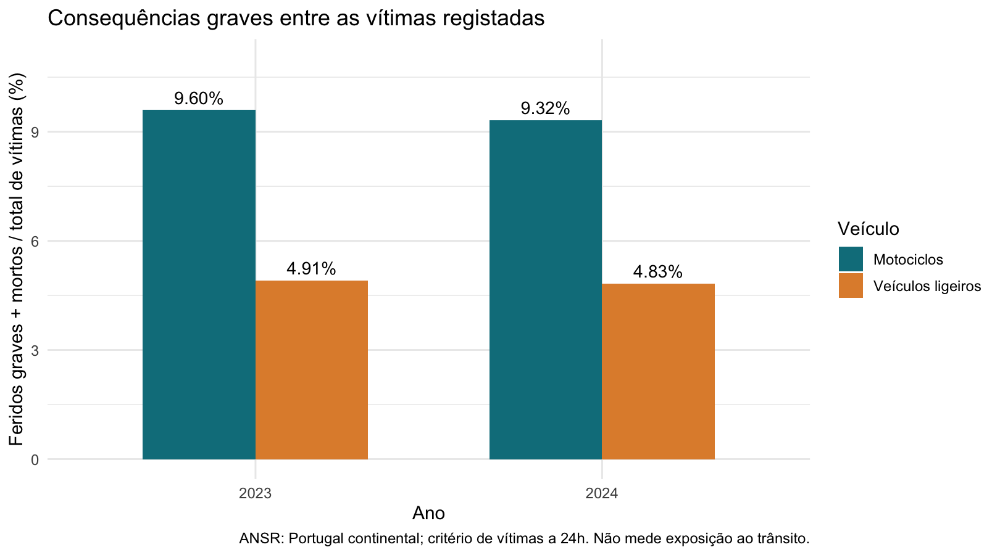
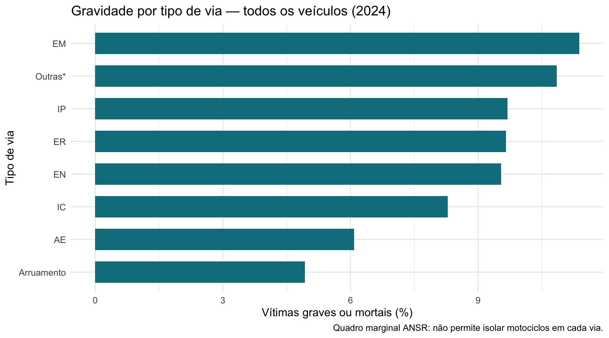
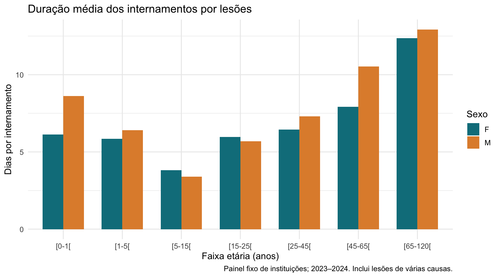
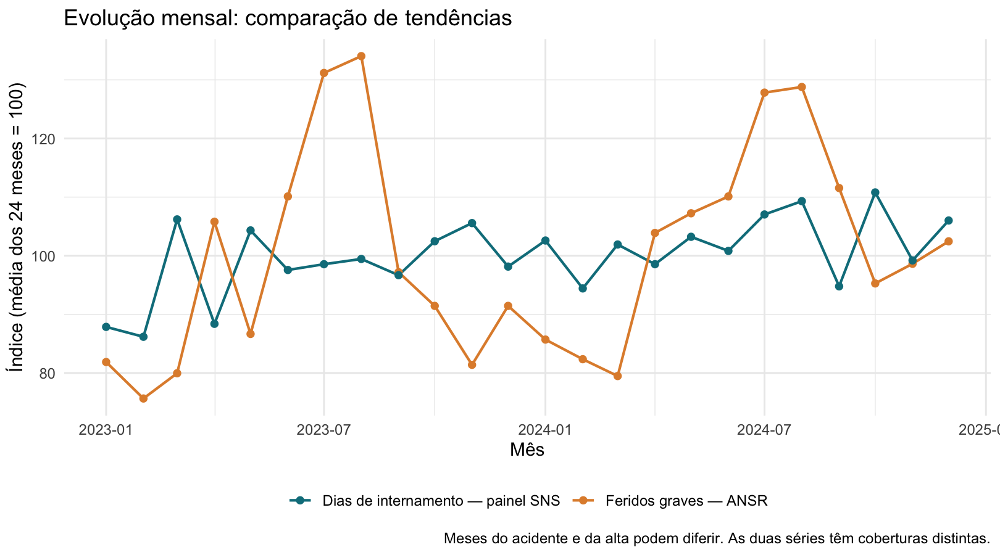
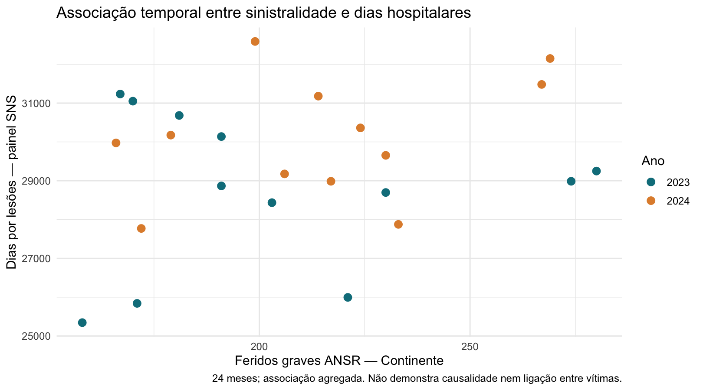
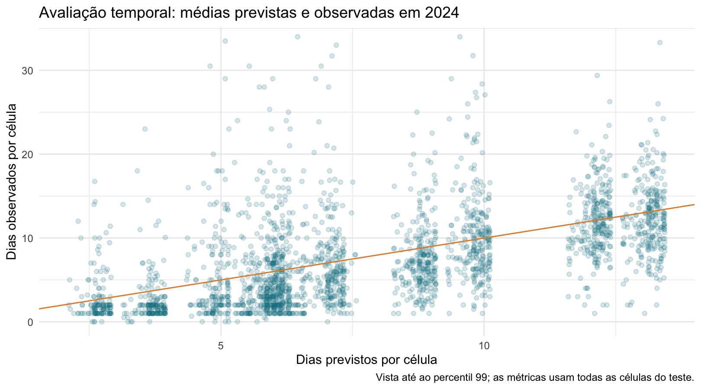

```{r preparacao, include=FALSE}
knitr::opts_chunk$set(echo = FALSE, message = FALSE, warning = FALSE,
                     fig.width = 9, fig.height = 5, dpi = 160)
source("executar_M4.R", encoding = "UTF-8")
source("R/06_exportar_graficos.R", encoding = "UTF-8")
exportar_graficos(6)
source("config/ler_repositorio.R", encoding = "UTF-8")
repo_url <- ler_repositorio()
fmt <- function(x, d = 2) formatC(x, format = "f", digits = d, decimal.mark = ",", big.mark = " ")
v24 <- comparacao_veiculos %>% filter(ano == 2024)
m24 <- v24 %>% filter(veiculo == "Motociclos")
l24 <- v24 %>% filter(veiculo == "Veículos ligeiros")
via24 <- ansr_vias %>% filter(ano == 2024) %>% arrange(desc(proporcao_grave))
rho <- associacoes$rho_dias[associacoes$periodo_analise == "Total"]
melhoria_mae <- 100 * (1 - avaliacao$MAE_dias[1] / avaliacao$MAE_dias[2])
coef_fg <- coef(associacao_ajustada)["feridos_graves"]
```

**Unidade curricular:** Seminário de Sistemas e Aplicações — Ciência dos Dados e ecossistema R.  
**Instituição:** Universidade Fernando Pessoa — 2026/2027.  
**Docente:** Luis Borges Gouveia.  
`r if (nzchar(repo_url)) paste0("**Repositório GitHub:** ", repo_url) else ""`
**Versão dos dados:** ficheiros oficiais descarregados em 6 de outubro de 2026; a análise usa as cópias preservadas em `data/raw/`.

# Resumo executivo

Este projeto compara a gravidade das vítimas de acidentes rodoviários em motociclos e veículos ligeiros e estuda indicadores hospitalares por lesões em Portugal continental entre 2023 e 2024. Utiliza o anexo Excel da ANSR e dados mensais de Morbilidade e Mortalidade Hospitalar do Portal Transparência SNS. A preparação em R detetou chaves hospitalares repetidas com valores distintos, pelo que foi selecionado um painel fixo de `r length(instituicoes_estaveis)` instituições, com `r nrow(sns_painel)` registos, para evitar somas ambíguas. Em 2024, a proporção de vítimas graves ou mortais foi de `r fmt(100*m24$proporcao_grave)`% nos motociclos e `r fmt(100*l24$proporcao_grave)`% nos veículos ligeiros: uma razão de `r fmt(comparacao_ratio$razao_proporcoes[comparacao_ratio$ano==2024])`. A associação mensal dos feridos graves com os dias hospitalares do painel foi fraca (Spearman = `r fmt(rho,3)`). A modelação agregada foi avaliada no ano seguinte, com comparação a uma referência simples. Os resultados apoiam a definição de prioridades de estudo e prevenção, mas não identificam a causa de cada lesão, não medem recuperação individual e não quantificam o impacto hospitalar atribuível às motas.

# Organização do relatório

| Momento | Foco | Elementos apresentados |
|:--|:--|:--|
| M1 | Introdução do projeto | Tema, motivação, problema e objetivos. |
| M2 | Delimitação do problema e dados | Quatro perguntas, âmbito, fontes e dicionário. |
| M3 | Qualidade e exploração | Limpeza, preparação, estatística, gráficos e estratégia. |
| M4 | Solução e interpretação | Modelo, avaliação, discussão, conclusões e limitações. |

As expressões **Pergunta 1 a Pergunta 4** identificam as questões científicas. As siglas **M1 a M4** identificam as entregas da unidade curricular.

# M1 Introdução do projeto

## Contexto e motivação

A segurança rodoviária exige compreender a gravidade das consequências dos acidentes, para além do número de ocorrências. Comparar veículos apenas pelo total de vítimas pode ocultar diferenças na proporção de consequências graves. Ao mesmo tempo, os internamentos por lesões representam utilização de recursos hospitalares, embora incluam causas muito diferentes de acidentes rodoviários.

A motivação deste estudo é compreender as consequências da sinistralidade para além das contagens de acidentes. A comparação entre categorias de veículo e a exploração de indicadores hospitalares permitem formular prioridades de prevenção e identificar as limitações da informação pública disponível.

**Problema:** como diferem as consequências graves entre vítimas em motociclos e veículos ligeiros, e que padrões de gravidade rodoviária e utilização hospitalar por lesões se observam nos dados disponíveis?

**Objetivo geral:** comparar a gravidade rodoviária e explorar padrões hospitalares e associações temporais, para apoiar prioridades de prevenção e de investigação.

**Objetivos específicos:** calcular proporções comparáveis por veículo; analisar diferenças por tipo de via; caracterizar a duração média dos internamentos por idade, sexo e região; avaliar uma associação temporal entre as duas fontes; testar um modelo simples para médias hospitalares agregadas.

# M2 Delimitação do problema perguntas analíticas e identificação de dados

## Perguntas de investigação e âmbito

| Pergunta | Dados e método | O que permite concluir |
|:--|:--|:--|
| Pergunta 1. A proporção de vítimas graves ou mortais difere entre motociclos e veículos ligeiros em 2023–2024? | ANSR: proporções, diferença em pontos percentuais e razão de proporções, por ano. | Comparação entre vítimas registadas; sem risco por condutor ou quilómetro. |
| Pergunta 2. Como varia a proporção de consequências graves entre tipos de via? | ANSR: cruzamento via × categorias de gravidade, com comparação proporcional. | Padrões por via para todos os veículos; sem ajuste por velocidade ou exposição. |
| Pergunta 3. Como varia a duração média do internamento por lesões com idade, sexo e região, e pode um modelo antecipar médias de 2024? | SNS: razões de totais e regressão ponderada, treino em 2023 e teste em 2024. | Padrões e previsões por célula agregada do painel. |
| Pergunta 4. A sinistralidade grave mensal acompanha a utilização hospitalar por lesões nas instituições selecionadas? | Join por mês, correlação de Spearman e regressão descritiva com tendência e sazonalidade. | Associação de séries; sem atribuir internamentos a acidentes. |

O período comum é janeiro de 2023 a dezembro de 2024. A ANSR apresenta dados detalhados do Continente com critério de vítimas a 24 horas. Não se misturam estes valores com relatórios a 30 dias. A categoria de comparação disponível é **veículos ligeiros**: não se afirma que todos são automóveis ligeiros de passageiros. Os ciclomotores ficam separados dos motociclos.

A fonte hospitalar refere-se ao mês de **alta**, enquanto a ANSR se refere ao mês do acidente. Mesmo uma vítima internada após um acidente pode ter alta num mês diferente. O cruzamento é, portanto, ecológico: compara períodos, sem identificar pessoas comuns às fontes.

## Metodologia e dados

### Fontes e unidade de observação

A ANSR disponibiliza o anexo ao Relatório Anual de Sinistralidade a 24 horas de 2024. Foram usados três quadros: quadro 4, contagens mensais; quadro 13, tipo de via; quadro 19, vítimas por veículo. Cada um contém comparações com 2023. O ficheiro tem títulos, células unidas e quadros de percentagens, exigindo extração estrutural. O relatório de 2024 identifica os dados desse ano como provisórios à data da edição; essa qualificação é preservada.

O conjunto SNS `morbilidade_mortalidade_hospit`, publicado pela ACSS, contém episódios, dias e óbitos por mês de alta, instituição, região, capítulo do diagnóstico principal, faixa etária e sexo. A aquisição foi filtrada para 2023–2024 e para o capítulo 19: **Lesões, envenenamento e algumas outras consequências de causas externas**. Não foram usados os conjuntos trimestrais de taxas com nomes semelhantes.

Uma linha SNS é um **registo agregado**, não um doente nem um acidente. Os `r nrow(sns_raw)` registos de origem têm 11 colunas; depois da seleção de qualidade, o conjunto principal tem `r nrow(sns_painel)` linhas. Período, instituição, região, idade, sexo, internamentos, dias, ambulatório e óbitos fornecem pelo menos oito variáveis relevantes com tipos diferentes. Código e descrição do capítulo são constantes neste recorte e não são apresentados como preditores informativos.

### Dicionário de dados

| Variável original SNS | Tipo | Significado e utilização |
|:--|:--|:--|
| `periodo` | Texto convertido em data mensal | Ano/mês de alta; chave temporal do cruzamento. |
| `regiao` | Categórica | Região da instituição; não residência do doente. |
| `instituicao` | Categórica | Instituição hospitalar; seleção e cobertura do painel. |
| `cod_capitulo` | Código | Capítulo do diagnóstico; filtro 19. |
| `desc_capitulo` | Texto | Descrição do capítulo; validação do filtro. |
| `faixa_etaria` | Categórica ordenável | Intervalo de idade, por exemplo [15–25[. |
| `sexo` | Categórica | Sexo publicado: F ou M. |
| `internamentos` | Numérica discreta | Número de episódios de internamento. |
| `dias_internamentos` | Numérica discreta | Total de dias associado aos episódios publicados. |
| `ambulatorios` | Numérica discreta | Episódios de ambulatório; controlo da estrutura, fora do denominador da duração. |
| `obitos` | Numérica discreta | Episódios com destino de alta falecido; não causa de morte rodoviária. |

| Variável ANSR/derivada | Tipo | Definição |
|:--|:--|:--|
| `ano`, `mes`, `periodo` | Tempo | Período do acidente nas tabelas ANSR. |
| `veiculo`, `via` | Categóricas | Categorias em quadros distintos, sem combinação veículo × via. |
| `acidentes` | Contagem | Acidentes com vítimas. |
| `mortos`, `feridos_graves`, `feridos_leves` | Contagens | Categorias do critério ANSR a 24h. |
| `total_vitimas` | Contagem | Mortos + feridos graves + feridos leves. |
| `proporcao_grave` | Numérica contínua | (Mortos + feridos graves) / total de vítimas. |
| `duracao_media` | Numérica contínua | Dias de internamento / episódios; indefinida quando episódios = 0. |
| `sin_mes`, `cos_mes` | Numéricas contínuas | Representação simples da sazonalidade anual. |

Nos intervalos [a–b[, a idade a pertence ao grupo e a idade b fica no grupo seguinte. A expressão "proporção grave" é criada para este estudo e não corresponde ao índice de gravidade oficial ANSR, que tem outro denominador.

### Indicadores e ferramentas

A proporção de consequências graves é calculada por:

`proporção grave = (feridos graves + mortos) / total de vítimas`

A duração média por grupo resulta de:

`duração média = soma dos dias / soma dos internamentos`

Por exemplo, 1200 dias distribuídos por 150 episódios correspondem a oito dias por episódio. Isto não representa oito dias até à recuperação clínica. A razão de totais pondera corretamente grupos com dimensões diferentes; uma média simples das médias não o faria.

A análise usa R e RStudio, `readr`, `readxl`, `dplyr`, `tidyr` e `ggplot2`. O relatório usa R Markdown/`knitr`, e o projeto inclui Git. As tabelas estatísticas, os ajustes e os gráficos são produzidos pelos scripts R.

# M3 Qualidade preparação de dados EDA e estratégia de análise

EDA significa *Exploratory Data Analysis*, ou **Análise Exploratória dos Dados**. Esta fase usa tabelas, indicadores e gráficos para compreender a distribuição dos dados, identificar padrões e avaliar a sua qualidade antes da modelação final.

## Preparação e qualidade

## Omissos e validação

A importação é seguida de validação das colunas, datas, contagens não negativas, valores inteiros e consistência entre óbitos e internamentos. A auditoria abaixo descreve a versão preservada.

```{r auditoria}
knitr::kable(auditoria, col.names = c("Verificação", "Valor"))
```

```{r omissos}
knitr::kable(omissos, col.names = c("Variável", "Valores ausentes"))
```

Não foram encontrados valores em falta nesta extração. O código produz uma auditoria e interrompe a execução se uma atualização introduzir omissos nas contagens. As células publicadas com zero episódios são mantidas nas agregações de contagens; a sua duração média fica como NA e não entra no modelo. Uma célula que não foi publicada não é preenchida com zero.

## Chaves repetidas e escolha do painel

A chave analisada é mês + região + instituição + capítulo + faixa etária + sexo. Existem `r nrow(chaves_repetidas)` chaves com mais de uma linha e `r sum(chaves_repetidas$n_registos-1)` linhas excedentes, mas nenhuma linha inteiramente idêntica. Sem documentação adicional, não é possível concluir se estas linhas são parcelas somáveis ou versões parcialmente sobrepostas.

Por prudência, foram excluídas da análise principal as `r length(instituicoes_ambiguas)` instituições com qualquer chave ambígua. A seleção restante contém `r length(instituicoes_estaveis)` instituições com presença nos 24 meses, num total de `r nrow(sns_painel)` linhas. A lista de exclusões e os respetivos registos ficam em `resultados/` para inspeção. Esta estratégia evita mudanças mensais arbitrárias da lista de instituições, mas sacrifica cobertura e pode introduzir enviesamento de seleção.

```{r cobertura}
knitr::kable(resumo_regiao, digits = 2, col.names = c("Região", "Instituições", "Episódios", "Dias", "Dias/episódio"))
```

O painel cobre instituições do Norte, Centro, LVT e Alentejo; o Algarve não está representado após esta regra. Não é uma amostra aleatória nem um retrato completo do SNS. As comparações regionais são perfis descritivos das instituições retidas, não taxas populacionais.

## Valores extremos e transformações

São sinalizadas `r nrow(extremos)` células com duração média superior a `r fmt(limite_iqr)` dias, usando o limite Q3 + 1,5 × IQR. Estes valores são mantidos na análise principal: internamentos longos podem ser reais e os dados são agregados. Retirá-los apenas porque são elevados poderia reduzir artificialmente o impacto observado. No modelo, uma sensibilidade separada aprende o limite apenas no treino e mantém o teste completo.

Na ANSR, removem-se títulos, totais e quadros de variações; preservam-se as contagens. As proporções são recalculadas. Não se somam quadros de veículo, via e mês entre si: descrevem as mesmas vítimas em margens diferentes. Não existe informação suficiente para afirmar em que via aconteceram os acidentes dos motociclistas.

## Cruzamento temporal

Os hospitais são agregados a uma linha por mês e a ANSR também tem uma linha por mês. O join usa o mês/ano comum, verifica unicidade das chaves e confirma 24 correspondências. Os internamentos não são repetidos em linhas para mota e carro.

```{r codigo_join, echo=TRUE, eval=FALSE}
cruzamento <- inner_join(ansr_mensal, sns_mensal, by = "periodo")
stopifnot(nrow(cruzamento) == 24)
```

Este join coloca em paralelo a sinistralidade do Continente e as altas por lesões do painel, com coberturas diferentes. Não permite estimar quantos internamentos foram causados por acidentes rodoviários, nem obter tempo de recuperação por veículo.

## Análise exploratória dos dados

### Pergunta 1 — Motociclos versus veículos ligeiros

```{r tab_veiculos}
knitr::kable(comparacao_veiculos %>% select(ano, veiculo, mortos, feridos_graves, feridos_leves, total_vitimas, proporcao_grave) %>%
  mutate(proporcao_grave = 100 * proporcao_grave), digits = 2,
  col.names = c("Ano", "Veículo", "Mortos", "Graves", "Leves", "Total", "Graves/mortos (%)"))
```

```{r grafico1}

```

Em 2024, os motociclos apresentaram `r m24$graves_mortos` vítimas graves ou mortais em `r m24$total_vitimas` vítimas; os veículos ligeiros apresentaram `r l24$graves_mortos` em `r l24$total_vitimas`. A razão de proporções foi `r fmt(comparacao_ratio$razao_proporcoes[comparacao_ratio$ano==2024])`, com uma diferença de `r fmt(comparacao_ratio$diferenca_pp[comparacao_ratio$ano==2024])` pontos percentuais.

```{r tab_ratio}
knitr::kable(comparacao_ratio %>% select(ano, razao_proporcoes, diferenca_pp), digits = 3,
  col.names = c("Ano", "Razão de proporções", "Diferença (p.p.)"))
```

A diferença é uma descrição das vítimas registadas. Não demonstra que usar mota duplica o risco de acidente: seriam necessários dados de exposição, como quilómetros percorridos, viagens ou condutores. Também não ajusta idade, velocidade, tipo de via ou equipamento de proteção. Não se calculam testes com milhares de vítimas tratadas como observações independentes, pois o mesmo acidente pode produzir várias vítimas.

### Pergunta 2 — Gravidade por tipo de via

```{r grafico2}

```

Em 2024, a maior proporção observada no quadro de vias foi `r via24$via[1]`, com `r fmt(100*via24$proporcao_grave[1])`%. Esta comparação considera todos os veículos e não permite isolar motas por tipo de via. Diferenças podem refletir velocidade, ocupação, fluxos, tipologia de acidente e outros fatores não observados conjuntamente. A classificação não deve ser convertida numa atribuição de culpa à entidade gestora.

### Pergunta 3 — Perfil dos internamentos por lesões

```{r tab_hospitalar}
knitr::kable(resumo_hospitalar, digits = 2,
  col.names = c("Ano", "Episódios", "Dias", "Óbitos", "Dias/episódio"))
```

```{r grafico3}

```

O gráfico compara a razão de dias por episódio em cada faixa etária e sexo. Estas lesões incluem causas rodoviárias e não rodoviárias. A idade é observada por intervalos, não como idade exata, e não se conhece a gravidade clínica de cada episódio. Uma média elevada pode refletir composição de casos, tratamento ou organização hospitalar.

### Pergunta 4 — Associação temporal entre as fontes

```{r grafico4}

```

As séries foram convertidas num índice com média dos 24 meses igual a 100, para comparar a forma da evolução sem usar dois eixos com unidades distintas.

```{r grafico5}

```

```{r tab_cor}
knitr::kable(associacoes, digits = 3,
  col.names = c("Período", "Meses", "Spearman: episódios", "Spearman: dias"))
```

A correlação de Spearman dos feridos graves com os dias do painel foi `r fmt(rho,3)` nos 24 meses. Valores por ano ajudam a verificar se a associação global depende da diferença entre 2023 e 2024. Uma correlação próxima de zero sugere pouca associação monotónica nesta seleção; uma correlação positiva ou negativa descreve apenas o acompanhamento das séries.


```{r tab_sens}
knitr::kable(sensibilidade, digits = 3, col.names = c("Cenário", "Spearman: dias"))
```

O cenário de todas as linhas serve para mostrar o efeito de uma política alternativa de agregação; pode incluir sobrecontagem e não constitui uma estimativa oficial do total nacional. Se a associação variar entre cenários, a conclusão deve explicitar essa sensibilidade.

## Estratégia de análise para M4

A etapa seguinte utiliza uma regressão linear ponderada para estimar a duração média dos internamentos por célula hospitalar. Os preditores são faixa etária, sexo, região e sazonalidade. O treino usa 2023 e o teste usa 2024, com comparação à média ponderada de 2023. A avaliação considera MAE e RMSE em dias por célula. Uma análise adicional examina a associação temporal com ajuste por tendência e sazonalidade. Estes modelos estudam grupos e séries, sem estabelecer causalidade individual.

# M4 Demonstração da solução resultados e interpretação crítica

## Análise aprofundada da associação temporal

A regressão descritiva ajustada por tendência linear e seno/cosseno do mês produziu um coeficiente de `r fmt(coef_fg,3)` dias hospitalares por unidade adicional de feridos graves na série continental. Este coeficiente não tem interpretação clínica individual. Existem apenas 24 meses, cobertura incompleta e possível dependência temporal. Por isso não se apresentam os p-values usuais como prova confirmatória.

## Modelação e avaliação

A modelação responde à componente preditiva de Pergunta 3: estimar a média de dias hospitalares por célula, respeitando a unidade agregada disponível. É usada uma regressão linear ponderada por número de episódios, com faixa etária, sexo, região e sazonalidade mensal. O modelo foi ajustado em 2023 e avaliado nas células elegíveis de 2024.

```{r codigo_modelo, echo=TRUE, eval=FALSE}
modelo <- lm(duracao_media ~ faixa_etaria + sexo + regiao + sin_mes + cos_mes,
             data = treino, weights = internamentos)
teste$previsao <- predict(modelo, newdata = teste)
```

A separação temporal evita misturar aleatoriamente o mesmo período entre treino e teste. Como são as mesmas instituições em anos diferentes, a avaliação mede transferência para o ano seguinte no mesmo painel; não mede desempenho em hospitais novos. O modelo não inclui ano, veículo nem medidas hospitalares posteriores como preditores do próprio resultado.

Compara-se o modelo a uma referência que prevê sempre a duração média ponderada de 2023. São usados MAE e RMSE ponderados, em dias por célula. Estes erros não são calculados a partir de durações individuais de pacientes. O peso de episódios dá mais relevância a células com maior volume, mas não resolve todas as diferenças de variância e dependência entre instituições.

```{r avaliacao}
knitr::kable(avaliacao, digits = 3,
  col.names = c("Método", "MAE (dias)", "RMSE (dias)", "Células de teste"))
```

O MAE do modelo principal foi `r fmt(avaliacao$MAE_dias[1],3)` dias e o da referência foi `r fmt(avaliacao$MAE_dias[2],3)` dias. A variação relativa foi `r fmt(melhoria_mae)`% (`r if(melhoria_mae > 0) "redução do erro" else "aumento do erro"`). A escolha final deve seguir o desempenho observado; um modelo mais complexo não é automaticamente melhor.

```{r grafico6}

```

O gráfico mostra dispersão entre médias previstas e observadas. Valores extremos são usados nas métricas, embora o eixo de apresentação seja limitado ao percentil 99. A tabela de previsões guarda todos os casos. A análise de sensibilidade refaz o treino sem médias acima do limite IQR de 2023 e avalia o mesmo teste, sem remover os erros difíceis de 2024.

A regressão linear pode produzir durações negativas fora do domínio observado. Nesta execução foram identificadas `r sum(teste$previsao < 0)` previsões negativas. A ausência de negativos neste teste não garante validade futura. Distribuições assimétricas, gravidade clínica desconhecida e dependência por hospital limitam o modelo; os coeficientes são descritivos e não provas de causalidade.

## Discussão e apoio à decisão

Pergunta 1 mostra uma diferença entre categorias de veículos entre as vítimas registadas. Este resultado justifica priorizar a análise da proteção de motociclistas, sem substituir um estudo de exposição ao trânsito. Pergunta 2 identifica vias com consequências proporcionalmente mais graves, que podem orientar auditorias e recolha de informação adicional. Pergunta 3 mostra perfis hospitalares e permite testar um modelo com avaliação fora do ano de treino. Pergunta 4 examina uma possível associação de contexto, mas não faz ligação clínica entre as fontes.

| Evidência disponível | Decisão que pode apoiar | Informação adicional necessária |
|:--|:--|:--|
| Maior proporção de consequências graves em motociclos | Priorizar campanhas e estudo de proteção de motociclistas. | Exposição, equipamento, velocidade e características individuais. |
| Diferenças por tipo de via | Selecionar vias para análise técnica e auditorias. | Tráfego, extensão, velocidade e localização dos acidentes. |
| Diferenças nas médias hospitalares agregadas | Investigar necessidades de cuidados nos grupos observados. | Diagnóstico detalhado, gravidade e processos de alta. |
| Associação temporal entre séries | Formular hipóteses para estudos de ligação de dados. | Identificação de causa externa e cobertura comparável. |

ANSR e forças de segurança podem usar resultados para formular prioridades de prevenção; gestores de vias para orientar investigações de infraestrutura; entidades de saúde para formular perguntas sobre utilização hospitalar. Estas são entidades com capacidade de intervenção, não responsáveis culpados identificados pelo modelo. Não se conclui que uma campanha específica reduzirá acidentes sem avaliar a intervenção.

## Conclusões

**Pergunta 1:** em 2024, a proporção de vítimas graves ou mortais foi superior nos motociclos (`r fmt(100*m24$proporcao_grave)`%) à dos veículos ligeiros (`r fmt(100*l24$proporcao_grave)`%), numa razão de `r fmt(comparacao_ratio$razao_proporcoes[comparacao_ratio$ano==2024])`. O resultado refere-se às vítimas registadas e não ao risco por pessoa exposta.

**Pergunta 2:** o quadro por tipo de via apresenta diferenças na proporção de consequências graves. Em 2024, `r via24$via[1]` apresentou a maior proporção neste quadro. Não é possível atribuir essa diferença exclusivamente à via nem isolar nela os motociclos.

**Pergunta 3:** os dados hospitalares permitem comparar duração média por grupos e ajustar um modelo agregado. O teste temporal apresentou MAE de `r fmt(avaliacao$MAE_dias[1],3)` dias, comparado com `r fmt(avaliacao$MAE_dias[2],3)` dias na referência. Este resultado caracteriza a previsão de médias de células no painel; não estima a recuperação individual.

**Pergunta 4:** foi possível cruzar 24 meses das duas fontes, com Spearman de `r fmt(rho,3)` entre feridos graves e dias por lesões. A associação global é fraca e muda de sinal no cenário que soma todas as linhas. Não foi identificada uma relação temporal robusta neste recorte. Isso não demonstra ausência de impacto clínico dos acidentes: as lesões hospitalares têm várias causas e as coberturas diferem. Não é possível quantificar o impacto específico das motas ou carros.

A principal contribuição do projeto é um processo reprodutível de Ciência de Dados com fontes oficiais, diagnóstico de qualidade, preparação justificada, comparação de proporções, exploração visual e modelação avaliada. A identificação de uma limitação de dados é também um resultado relevante: impede conclusões que as fontes públicas não sustentam.

## Limitações e trabalho futuro

As principais limitações são a agregação dos dados, a ausência de causa externa por veículo no SNS, a seleção não aleatória do painel, a exclusão do Algarve, diferenças entre mês do acidente e mês de alta, dados ANSR de 2024 provisórios na edição utilizada, ausência de exposição ao trânsito e apenas dois anos de observação. As altas não representam todas as lesões ocorridas no mês; a codificação pode ter atrasos e revisões.

As mesmas instituições aparecem em vários meses. A regressão descritiva e as métricas ponderadas não corrigem integralmente essa dependência. Não há dados individuais de alta com recuperação, sequelas, reabilitação ou retorno ao trabalho. Também não há uma ligação entre vítimas e episódios: internamento não equivale a pessoa única.

Como trabalho futuro, deve esclarecer-se com o produtor a origem das chaves repetidas, aumentar o período temporal, obter categorias de causas externas relacionadas com transportes, estudar modelos positivos para médias e ajustar a dependência por instituição. Uma ligação entre dados rodoviários e clínicos só deve ser considerada com acesso autorizado e critérios de correspondência documentados. Para comparar riscos de veículos seriam necessários denominadores de exposição.

# Referências

AUTORIDADE NACIONAL DE SEGURANÇA RODOVIÁRIA. *Relatório Anual de Sinistralidade 24h e fiscalização rodoviária de 2024* e respetivo anexo Excel. 2025. Disponível em: <https://observatorioansr.pt/relatorios/>. Acesso em: 6 out. 2026.

ADMINISTRAÇÃO CENTRAL DO SISTEMA DE SAÚDE. *Morbilidade e Mortalidade Hospitalar*. Portal Transparência SNS, identificador `morbilidade_mortalidade_hospit`. Disponível em: <https://transparencia.sns.gov.pt/explore/assets/morbilidade_mortalidade_hospit/>. Acesso em: 6 out. 2026.

GOUVEIA, Luis Borges. *Guião de projeto: Seminário de Sistemas e Aplicações*. UFP, v. 1.2, set. 2026. Documento fornecido na unidade curricular.

R CORE TEAM. *R: Fitting Linear Models — lm*. Documentação do R. Disponível em: <https://stat.ethz.ch/R-manual/R-devel/library/stats/html/lm.html>. Acesso em: 6 out. 2026.

POSIT. *Tutorial: Hello, Quarto / RStudio*. Disponível em: <https://quarto.org/docs/get-started/hello/rstudio.html>. Acesso em: 6 out. 2026.

# Anexo A Organização técnica e reprodutibilidade

Os momentos de entrega integram um único estudo: M1 apresenta o domínio e a motivação; M2 delimita o problema e identifica os dados; M3 prepara e explora a informação; M4 reúne a modelação, a interpretação e as conclusões.

| Componente | Ficheiro ou pasta | Conteúdo |
|:--|:--|:--|
| M1 | `M1_uma_pagina.Rmd` | Enquadramento e proposta inicial. |
| M2 | `M2.Rmd` e `executar_M2.R` | Perguntas, dados disponíveis, dicionário e importação. |
| M3 | `M3.Rmd` e `executar_M3.R` | Auditoria, preparação, dados limpos e exploração visual. |
| M4 | `M4.Rmd` e `executar_M4.R` | Modelação, avaliação e conclusões. |
| Fontes preservadas | `data/raw/` | Ficheiros oficiais e metadados da aquisição. |
| Dados preparados | `data/processed/` | Tabelas analíticas e cruzamento mensal. |
| Código R | `R/` | Ambiente, importação, limpeza, exploração e modelação. |
| Resultados | `resultados/` | Auditorias, tabelas, gráficos, previsões e informação de sessão. |

A execução utiliza caminhos relativos. Os dados originais estão preservados para permitir reproduzir a análise com a mesma versão das fontes. O controlo de versões é feito com Git. A sequência de execução é M2, M3 e M4; o ficheiro `executar.R` executa o fluxo completo. Os documentos R Markdown integram código, texto, tabelas e gráficos.

`r if (nzchar(repo_url)) paste0("O repositório do projeto está disponível em: ", repo_url, ".") else ""`
